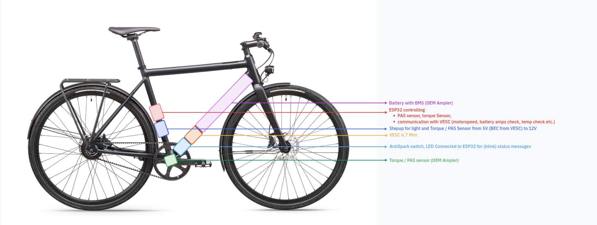

# Tailwind

An e-bike controller built on ESP32 with dual-core architecture for responsive pedal assist control. This project implements speed-dependent assist profiles with real-time sensor processing and VESC motor controller integration.

## Table of Contents

- [What the ESP32 Does](#what-the-esp32-does)
  - [Core Functionality](#core-functionality)
  - [How It Works](#how-it-works)
    - [Multi-Core Architecture](#multi-core-architecture)
    - [Speed-Dependent Assist Algorithm](#speed-dependent-assist-algorithm)
    - [Sensor Integration](#sensor-integration)
    - [VESC Communication Protocol](#vesc-communication-protocol)
- [System Components](#system-components)
- [Safety Features](#safety-features)
- [Getting Started](#getting-started)
  - [Hardware Setup](#hardware-setup)
  - [Software Configuration](#software-configuration)
- [Code Structure](#code-structure)
- [Key Features](#key-features)
- [Debug Mode](#debug-mode)
  - [Debug Features](#debug-features)
  - [Debug Modes](#debug-modes)
  - [Simulation Modes](#simulation-modes)
  - [Debug Configuration](#debug-configuration)
  - [Serial Monitor Output](#serial-monitor-output)
- [WiFi Web Interface](#wifi-web-interface)
  - [How to Access](#how-to-access)
  - [Assist Profiles](#assist-profiles)
  - [Ride Recording](#ride-recording)
  - [HTTP API](#http-api)
- [USB Ride Diagnostics](#usb-ride-diagnostics)
- [Legal Compliance](#legal-compliance)
- [Configuration](#configuration)
- [Contributing](#contributing)
- [License](#license)



## What the ESP32 Does

The ESP32 acts as the intelligent brain of the tailwind system, processing multiple sensor inputs and controlling motor assistance in real-time. Here's how it works:

### Core Functionality
- **Pedal Assist Control**: Monitors pedal activity through PAS (Pedal Assist Sensor) and provides appropriate motor assistance
- **Speed-Dependent Assistance**: Dynamically adjusts assist levels based on current speed using interpolated curves
- **Torque Sensing**: Reads rider torque input for more natural and responsive assistance
- **VESC Integration**: Communicates with VESC motor controller via UART for motor control and telemetry
- **Safety Monitoring**: Continuously monitors battery voltage, temperature, and system health

### How It Works

#### Multi-Core Architektur
The ESP32's dual-core processor is utilized for optimal performance:

- **Core 0 (Sensor Core)**: Handles time-critical sensor processing
  - PAS sensor interrupts and debouncing
  - Torque sensor ADC readings
  - Assist level calculations
  - Mode switching and button inputs

- **Core 1 (Communication Core)**: Manages external communication
  - VESC UART communication
  - Speed data retrieval
  - Motor control commands
  - Debug output and monitoring

#### Speed-Dependent Assist Algorithm

| Mode | API ID | GPIO4 LED flashes | Assistance |
|------|--------|-------------------|------------|
| Urban | `0` | 1 | Default at startup. Multiplies rider power using the speed curve below. |
| Max Power | `1` | 2 | Requests up to 350 W of assistance once forward pedaling is confirmed, subject to the 15 A motor-current command limit and VESC limits. |
| Aus | `2` | 3 | Disables motor assistance. |
| Custom | `3` | 4 | Multiplies rider power using the curve saved from the web interface. |

Backpedal one full revolution (32 valid reverse sensor transitions) to advance through Urban → Max Power → Aus → Custom → Urban. Forward pedaling or a pause clears a partial revolution. Max Power turns on the GPIO2 status LED.

| Speed (km/h) | 0 | 5 | 10 | 15 | 20 | 25 | 30 | 35 | 40 |
|--------------|---|---|----|----|----|----|----|----|----|
| Urban multiplier | 6 | 4 | 3 | 3.5 | 4.5 | 5.5 | 6.5 | 7.5 | 8.5 |

Urban retains the previous launch behavior with a factor of 6 at 0 km/h and 4 while moving through 5 km/h. Above 5 km/h it interpolates between the configured points, giving the calculated values shown at 25 and 35 km/h. The multiplier stays at 8.5 above 40 km/h. The existing overspeed stop still applies when measured speed exceeds 45 km/h.

#### Sensor Integration

**PAS (Pedal Assist Sensor)**
- 8 hall sensors per crank revolution
- Interrupt-driven with hardware debouncing
- Calculates pedaling cadence and direction
- Provides immediate assist activation/deactivation

**Torque Sensor**
- Analog strain gauge measurement
- 12V supply via step-up converter
- Real-time torque-based assist scaling
- Natural riding feel with proportional assistance

**Speed Sensor**
- Derived from VESC eRPM data
- Motor pole pairs and gear ratio calculation
- Accurate speed measurement for assist curves
- Used for legal speed limit compliance

#### VESC Communication Protocol

The system communicates with the VESC motor controller using:
- UART protocol at 115200 baud
- Real-time telemetry data retrieval
- Current-based motor control commands
- Battery monitoring and protection

## System Components

- **Microcontroller**: ESP32 DevKit v1 (dual-core, 3.3V logic)
- **Motor Controller**: VESC (Flipsky FESC 6.7 pro mini)
- **Motor**: Q100C CST 36V/350W Hub Motor with 14.2:1 gear ratio
- **Battery**: 48V 13S2P Li-ion with integrated BMS
- **Sensors**: PAS hall sensors, analog torque sensor, optional wheel speed sensor
- **Additional**: Logic level converters, step-up converter, MOSFET headlight control

## Safety Features

- **Battery Protection**: Voltage monitoring with automatic cutoff
- **Thermal Protection**: Temperature monitoring and throttling
- **Speed Limiting**: Configurable maximum assist speed
- **Fault Detection**: System health monitoring with error codes
- **Fail-Safe**: Graceful degradation when sensors fail

## Getting Started

### Hardware Setup
For complete wiring instructions and component connections, see [Wiring Guide](/_documentation/Wiring.md).

### Software Configuration
1. Install PlatformIO IDE
2. Clone this repository
3. Configure your specific motor and battery parameters in `include/tailwind_controller.h`
4. Upload the `esp32doit-devkit-v1` environment to the ESP32. WiFi is enabled by default on this branch.

The ESP32 build excludes the BLE module, whose [source](src/ble_telemetry.cpp) and [API reference](_documentation/BLE_API_Reference.md) remain in the repository. The HTML page is served from flash, and WiFi startup reports the available heap over USB serial.

## Code Structure

```
src/
├── main.cpp              # Multi-core initialization and main loops
├── config.cpp            # Assist profiles and global variables
├── assist_calculation.cpp # Speed-dependent assist algorithms
├── motor_control.cpp     # VESC control and safety limits
├── pas_sensor.cpp        # PAS interrupt handling and debouncing
├── torque_sensor.cpp     # Analog torque measurement
├── vesc_communication.cpp # UART protocol with VESC
├── mode_management.cpp   # User interface and mode switching
├── debug_output.cpp      # Serial monitoring and diagnostics
├── wifi_telemetry.cpp    # Access point and HTTP API
└── initialization.cpp    # Hardware setup and calibration
```

## Key Features

- ✅ **Real-time Performance**: Sub-millisecond sensor response times
- ✅ **Smooth Assistance**: Linear interpolation prevents power jerks
- ✅ **Energy Efficient**: Smart algorithms maximize range
- ✅ **User Friendly**: Simple mode switching with LED feedback
- ✅ **Diagnostic Tools**: Comprehensive debug output and monitoring
- ✅ **Safety First**: Multiple protection layers and fail-safes
- ✅ **WiFi Interface**: Live data, assist mode selection, and browser-based ride recording
- ✅ **Open Source**: Fully documented and customizable

## Debug Mode

The system includes comprehensive debugging and testing capabilities for development and troubleshooting:

### Debug Features
- **Real-time Monitoring**: Serial output shows sensor states, speed, torque, and system status
- **Sensor Simulation**: Simulate PAS and torque sensors without physical hardware
- **Performance Analysis**: Monitor loop times, sensor response, and algorithm performance
- **Built-in LED Status**: GPIO2 LED indicates system status and debug information

### Debug Modes
1. **Normal Debug**: Real sensors with detailed serial output
2. **PAS Simulation**: Simulated pedal sensor for testing without pedaling
3. **Torque Simulation**: Simulated torque values for algorithm testing
4. **Systematic Testing**: Automated testing of all cadence/torque combinations

### Simulation Modes
- **Smooth Cycle**: Realistic cycling simulation with varying cadence and torque
- **Systematic Test**: Tests predefined combinations of cadence (20-120 RPM) and torque (5-40 Nm)

### Debug Configuration

Enable debug features in `include/tailwind_controller.h`:
```cpp
// debug_mode will skip reading real values from pas and torque and instead
// cycle through torque and cadence values automatically. 
// ATTENTION: it WILL SPIN the motor, so be aware that it actually can spin freely!!
bool debug_mode = true;              // Enable debug mode
bool debug_simulate_pas = false;     // Simulate PAS sensor / or use the physical sensor
bool debug_simulate_torque = false;  // Simulate torque sensor / or use the physical sensor
```

### Serial Monitor Output
The debug output shows:
- Sensor states (A/B hall sensors)
- Pedal direction and position
- Cadence in RPM
- Speed in km/h
- Raw and filtered torque values
- Current assist factor and motor current
- System warnings and error states

## WiFi Web Interface

### How to Access

1. Join the local WiFi network `Tailwind` with the WPA2 password `tailwind`.
2. Open [http://192.168.4.1](http://192.168.4.1) in your browser. The page shows live telemetry and lets you select Urban, Max Power, Aus, or Custom. The firmware starts in Urban and accepts reverse pedaling for mode selection.

### Assist Profiles

Select a curve from the profile menu. Custom can be edited by dragging the points or entering the multipliers directly. It starts with the Urban values at 0, 5, 10, 15, 20, 30, and 40 km/h and interpolates linearly between them. Each multiplier ranges from 0.0 to 10.0 in steps of 0.1. The saved curve persists on the ESP32 across power cycles. Choose the Custom ride mode to use the curve.

### Ride Recording

Start a ride on the webpage and keep the page open in the foreground. About once a second, the page stores a telemetry sample in IndexedDB on that device. Locking the screen, switching apps, or losing WiFi can cause gaps. Export a finished ride as CSV from the same browser. Clearing its site data removes the saved rides.

The ride shows net energy from the change in consumed Wh minus the change in returned Wh. A detected counter reset suppresses the net figure. The CSV includes both raw counters. The displayed speed is estimated from motor RPM and can drop to zero when the geared hub freewheels.

Starting a recording writes a ride record in the browser and uses the same status polling as live view. After a lost connection the dashboard compares the ESP boot ID to distinguish a reboot from a connection interruption. The status API and ride CSV include the ESP reset reason and boot ID.

### HTTP API

| Method | Path | Result |
| --- | --- | --- |
| GET | `/api/status` | JSON sample with mode, pedal data, commanded phase current, and VESC telemetry. Unavailable VESC values are `null`. |
| POST | `/api/mode` | Queues a mode change and returns HTTP 202. The next status sample confirms the active mode. |
| GET | `/api/profiles` | Returns curve speeds, Urban and saved Custom multipliers in tenths, and the Max Power ceiling. |
| POST | `/api/profiles` | Stores a Custom curve and returns HTTP 200. |

For a mode change, send `mode=0` (Urban), `mode=1` (Max Power), `mode=2` (Aus), or `mode=3` (Custom) as `application/x-www-form-urlencoded`. To save a curve, send seven comma-separated integers from 0 to 100 as `text/plain`, for example `60,40,30,35,45,65,85` for the default values. Both writes use the fixed AP IP and the header `X-Tailwind-Request: 1`.

In the status sample, `battery_a` comes from VESC input current and `motor_a` from motor phase current. `duty` is a fraction, so `0.5` means 50%. `watt_hours` and `watt_hours_charged` are cumulative VESC counters.

## USB Ride Diagnostics

Build the `esp32-usb-logging` PlatformIO environment for a diagnostic ride. Upload that environment to the ESP, then connect its USB port to an Android phone in USB host mode. Use **460800 baud, 8N1**, with flow control off. [UsbTerminal for Android](https://github.com/liorhass/UsbTerminal) supports the CH340 converter and session files. Start file logging before the first pedal stroke and export the raw text file. The ESP streams continuously after boot in this environment. The regular `esp32doit-devkit-v1` environment runs the WiFi dashboard at its usual 115200-baud console speed. WiFi is off in the USB environment so the measurement isolates the controls and VESC link.

Use `esp32-usb-logging-wifi` to run the dashboard and 460800-baud USB trace together. The USB trace continues while the browser starts, saves or stops a ride recording. The boot ID is shared between the USB and WiFi streams.

For Android capture problems, the `esp32-usb-logging-230400` environment provides the same USB trace at **230400 baud, 8N1**. Select that rate in the phone's serial settings for the comparison. The ESP sensor, VESC command, and VESC query rates are the same as in the 460800-baud build.

```sh
pio run -e esp32-usb-logging
python3 tools/usb_log_to_csv.py ride.txt
```

The converter produces `sensor.csv`, `commands.csv`, `vesc.csv`, and `boots.csv` and reports sequence gaps by boot and stream. The `uptime_us` values share an ESP clock within each `boot_id`. The log is saved by the USB host.

| Record | Nominal rate | What to compare at launch |
| --- | --- | --- |
| Sensor | 100 Hz | PAS movement and direction, calibrated and measured ADC values, torque and cadence, rider power, assist multiplier, requested power, limited and gated current. |
| Command | Up to 20 Hz | Actual UART dispatch and the `sensor_seq` of the command that the VESC task picked up. The VESC protocol's current command has no acknowledgment. |
| VESC | About 10 Hz | Query duration and reply status, motor and battery current, eRPM, duty, voltage, energy counters and fault code. |

For a comparison, capture a few starts from rest in Urban and Max Power. Match the sensor `seq` to `sensor_seq` in the UART command within the same boot, then look for rising motor current and eRPM in the VESC rows. Some sensor decisions are superseded before a UART dispatch. Motor-derived speed can read zero while the wheel freewheels. Phase current is measured by the VESC. Output torque and actual wheel speed while coasting require other measurements.

## Legal Compliance

**⚠️ Important Notice: This controller is NOT compliant with European e-bike regulations (EN 15194).**

This is an open-source project designed for:
- Research and educational purposes
- Private property use only
- Countries/regions without strict e-bike speed limitations
- Custom applications where regulations permit

**Key differences from EU regulations:**
- No 25 km/h speed limit enforcement
- Configurable Urban assist curve with speed points through 40 km/h
- No automatic power limitation at legal speeds
- Full user control over assist parameters

**User Responsibility:** It is the user's responsibility to ensure compliance with local laws and regulations when using this controller on public roads.

## Configuration

To customize the controller for your specific setup:

- **Hardware Settings**: Motor specifications, battery parameters, and pin assignments are configured in `include/tailwind_controller.h`
- **Assist Profiles**: Speed curves, assist modes, and behavior profiles are defined in `src/config.cpp`
- **Speed Points**: Modify the `SPEED_POINTS_KMH` array to change speed ranges for assist curves
- **Motor Parameters**: Adjust pole count, gear ratios, and power limits for your specific motor

## Contributing

This is an open-source project. Contributions, improvements, and adaptations are welcome! Please see the wiring documentation and code comments for technical details.

## License

This project is released under the MIT License. The hardware designs, software code, and documentation are freely available for:
- Personal use and modification
- Educational and research purposes
- Commercial and non-commercial applications
- Further development and improvement
- Distribution and selling of modified versions

The MIT License allows you to use, copy, modify, merge, publish, distribute, sublicense, and/or sell copies of this software, with the only requirement being to include the original copyright notice and license text.

Feel free to fork, modify, and share your improvements with the community!
